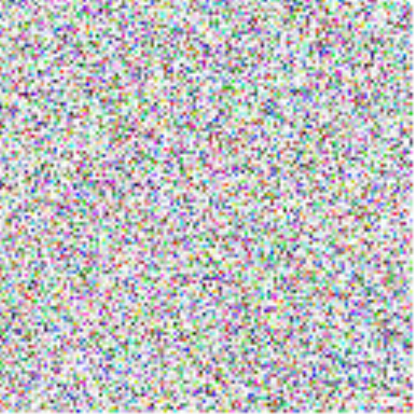

<p align="center">
  
</p>

# BAYAT Smart Network Optimizer

<p align="center"></p>

Windows için ağ bağlantısı, bağdaştırıcı envanteri ve bağlantı ölçümlerini görüntülemeye yardımcı olan WPF masaüstü uygulaması.

- **Yayıncı:** BAYAT
- **Mevcut proje sürümü:** 1.1.0
- **Hedef:** .NET 10 / WPF
- **Lisans:** GPL-3.0-only

## İndirme

Resmî sürümler yayımlandığında dosyalar GitHub **Releases** sayfasında bulunur:

**[GitHub Releases — İndir](https://github.com/BAYAT-DEV/BAYAT-Smart-Network-Optimizer/releases)**

İşlemci mimarinize uygun paketi seçin:

| Windows mimarisi | Paket |
|---|---|
| x64 | `SmartNetworkOptimizer-Setup-1.1.0-win-x64.exe` (kurulum) veya `SmartNetworkOptimizer-win-x64.zip` |
| ARM64 | `SmartNetworkOptimizer-win-arm64.zip` (taşınabilir ZIP) |

ARM64 cihazlarda x64 kurulum dosyasını kullanmayın. İndirme sayfasında yayımlanmamış dosyalar henüz indirilebilir değildir.

## Açık kaynak, test ve güvenlik şeffaflığı

Bu proje GPL-3.0-only lisansı altında açık kaynak olarak yayımlanır. Kaynak kodu bu depoda herkes tarafından görüntülenebilir, incelenebilir ve lisans koşulları çerçevesinde yeniden derlenebilir. GitHub Actions yayın iş akışı, Windows üzerinde otomatik testleri çalıştırmadan x64 ve ARM64 paketlerini üretmez; test adımları başarısız olursa yayın paketleme aşamasına geçilmez.

**Uygulamanın amacı ve test kapsamı:** Smart Network Optimizer; ağ bağdaştırıcısı ve bağlantı bilgilerini görüntülemek, canlı ping/RTT ölçümü yapmak, ölçüm sonuçlarını CSV olarak dışa aktarmak ve kullanıcı kontrolündeki ağ ayarı iş akışlarını sunmak için geliştirilmiştir. Uzaktan bilgisayar kontrolü veya kullanıcı parolalarını toplama, kişisel dosyaları gizlice aktarma gibi işlevler uygulamanın amaçlanan özellikleri değildir. Kaynak kodu herkesin incelemesine açıktır.

GitHub Actions, Windows üzerinde otomatik testleri çalıştırır ve test aşaması başarısız olursa paket üretimine geçmez. Testler belirli senaryoları kontrol eder; tek başına bağımsız, satır satır bir güvenlik denetimi anlamına gelmez ve hiçbir yazılım için tüm olası hata ve güvenlik açıklarının bulunmadığını kanıtlamaz. Kullanıcılar kaynak kodunu, testleri ve yayın iş akışını depodan inceleyebilir.

İndirilen dosyaların SHA256 değerini Release sayfasındaki eşleşen özetle karşılaştırın. GitHub Actions provenance/attestation bilgileri derleme kaynağını doğrulamaya yardımcı olur; dosyanın güvenli olduğunu tek başına kanıtlamaz ve Authenticode kod imzası değildir. Windows dosya özelliklerinde dijital imza/yayıncı bilgisi yoksa uygulama imzasızdır.

## Güvenlik bildirimi

**Önemli:** Authenticode kod imzası bulunmayan Windows uygulamaları SmartScreen tarafından “Bilinmeyen yayıncı” olarak gösterilebilir. SHA256 ve GitHub Actions provenance bilgileri dosya bütünlüğü ve derleme kaynağı doğrulamasına yardımcı olur; kod imzası veya SmartScreen itibarı sağlamaz.

“Bilinmeyen yayıncı” uyarısı, tek başına uygulamanın zararlı olduğunun tespiti değildir; Windows'un güvenilir bir yayıncı kod imzasını doğrulayamadığını bildirir. Kullanıcıları uyarıyı aşmaya, “Yine de çalıştır” seçeneğini kullanmaya veya Windows güvenlik korumalarını kapatmaya yönlendirmiyoruz. İmza durumu her sürümün indirme sayfasında açıkça belirtilmelidir.

## Kullanım kılavuzu

Türkçe kullanıcı kılavuzu: [docs/USER-GUIDE-TR.md](docs/USER-GUIDE-TR.md)

Kılavuz; doğru mimariyi seçme, SHA256 doğrulama, kurulum, taşınabilir kullanım, güvenli kullanım ve kaldırma adımlarını açıklar.

## Özellikler

- Sistem ve ağ bağdaştırıcısı envanteri
- Canlı ping/RTT ölçümü ve grafik
- Ölçüm örneklerini durdurma ve temizleme
- Kullanıcı tarafından başlatılan CSV dışa aktarımı
- Ağ ayarları için kontrollü öneri ve geri alma iş akışları

Sonuçlar donanım, sürücü, ağ ve servis sağlayıcısına bağlıdır. Belirli bir hız, gecikme veya oyun performansı artışı garanti edilmez. ICMP ping kaybı, UDP oyun paket kaybıyla aynı değildir.

## Derleme

Windows üzerinde .NET 10 SDK gerekir.

```powershell
.\publish.ps1 -RuntimeIdentifier win-x64
.\publish.ps1 -RuntimeIdentifier win-arm64
```

Çıktılar `artifacts` klasöründe oluşturulur. Yayın öncesinde testleri ve SHA256 değerlerini doğrulayın.

## Destek

Hata bildirimi ve öneriler: [GitHub Issues](https://github.com/BAYAT-DEV/BAYAT-Smart-Network-Optimizer/issues)

## Lisans

GPL-3.0-only. Tam metin için [LICENSE.txt](LICENSE.txt) dosyasına bakın. GPL bir yazılım lisansıdır; kod imzalama sertifikası değildir.
